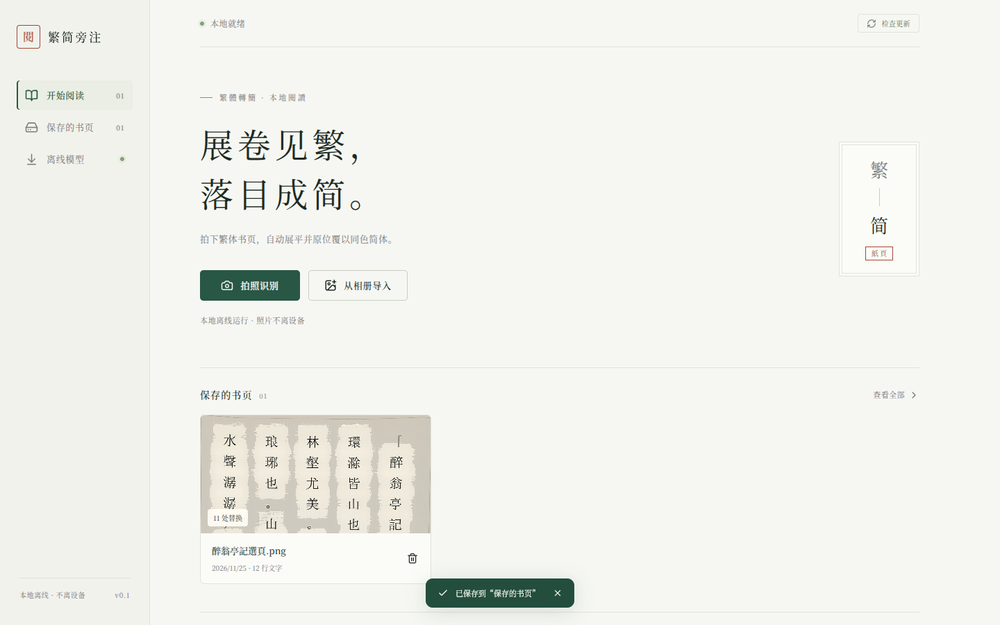
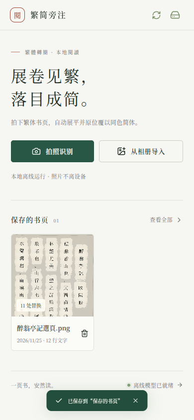
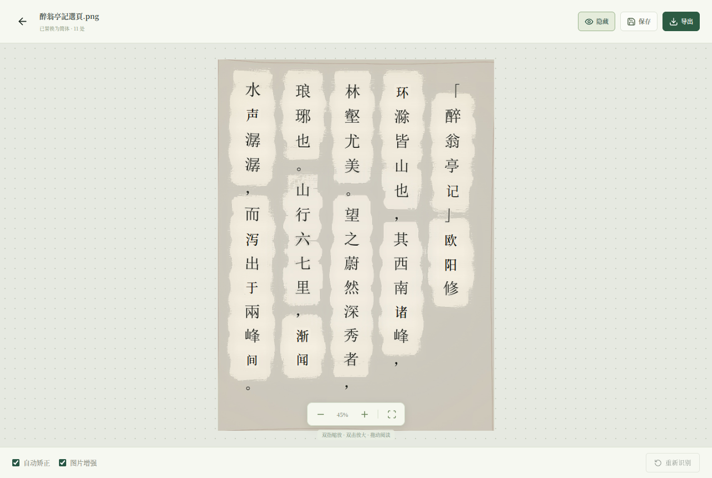
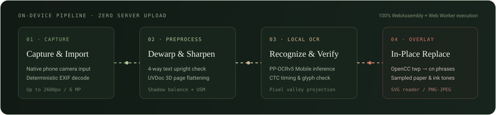

<p align="right">
  <a href="README.md">简体中文</a> · <strong>English</strong>
</p>

<div align="center">



<br />

<p>
  <a href="https://drivinggodj.github.io/fanjian-notes/"></a>
  
  
  
</p>

<p>
  <a href="https://drivinggodj.github.io/fanjian-notes/">Open App</a> ·
  <a href="#interface-showcase">Showcase</a> ·
  <a href="#key-features">Key Features</a> ·
  <a href="#how-it-works">How It Works</a> ·
  <a href="#documentation">Documentation</a>
</p>

</div>

> Capture a Traditional Chinese page and **Fanjian Notes** runs 3D page dewarping, sharpening, and OCR locally on your device—then replaces differing glyphs **in place with Simplified characters** sampled to match your paper background and ink tone. **Your photos and recognized text never leave your device.**

---

## Interface Showcase

Designed with a minimalist editorial book aesthetic powered by locally cached **Adobe Source Han Serif**, adapting automatically to your OS light and dark appearance.

<p align="center">
  <picture>
    <source media="(prefers-color-scheme: dark)" srcset="docs/screenshots/home-dark.png" />
    <source media="(prefers-color-scheme: light)" srcset="docs/screenshots/home.png" />
    
  </picture>
  <br />
  <sub>Desktop home interface (follows system light / dark theme automatically)</sub>
</p>

<table>
  <tr>
    <td width="33%" align="center" valign="top">
      
      <br />
      <sub><strong>Mobile Minimal Home</strong><br />Guides offline model installation first, then unlocks native camera capture and photo import</sub>
    </td>
    <td width="67%" align="center" valign="top">
      
      <br />
      <sub><strong>In-Place Adaptive Replacement (Real Local OCR)</strong><br />Focused 3-button Reader header (Show/Hide, Save, Export) + bottom toggles with seamless paper-matched Simplified glyphs</sub>
    </td>
  </tr>
</table>

---

## Key Features

<table>
  <tr>
    <td width="50%" valign="top">
      <h3>📐 Shoot Once — Auto 3D Dewarp &amp; Sharpen</h3>
      Launches the phone's native system camera directly for crisp high-res photos, fixes JPEG EXIF and flat-lay orientation, flattens spine curvature via local <strong>UVDoc 3D dewarping</strong>, and enhances legibility with local illumination normalization + Unsharp Mask. Toggle off auto-correct or enhancement and tap <strong>Re-recognize</strong> anytime.
    </td>
    <td width="50%" valign="top">
      <h3>🖋️ Seamless In-Place Adaptive Ink Overlay</h3>
      Uses whole-line <strong>OpenCC</strong> (<code>twp → cn</code>) conversion with anchor-isolated phrase alignment so local wording differences never hide surrounding characters. Samples local paper hue and ink density per glyph to cover Traditional characters seamlessly at full font size.
    </td>
  </tr>
  <tr>
    <td width="50%" valign="top">
      <h3>📖 Calm Reader &amp; Explicit Manual Save</h3>
      A zero-clutter viewport with pinch zoom, panning, and full-resolution PNG / JPEG export. Nothing is saved automatically by default—only pages you explicitly tap <strong>Save</strong> on remain stored locally inside <em>Saved Pages</em> (保存的书页).
    </td>
    <td width="50%" valign="top">
      <h3>🔒 100% Offline PWA with Mirror Failover</h3>
      Powered by React 19, PaddleOCR.js (PP-OCRv5 Mobile), and ONNX Runtime WebAssembly inside isolated Web Workers. After caching ~97 MB of assets once, works completely offline—complete with streaming download progress, CDN mirror failover, network diagnostics, and top-bar manual updates.
    </td>
  </tr>
</table>

---

## How It Works

<p align="center">
  
</p>

> [!NOTE]
> **Offline storage, privacy boundaries & known limits**:
> - **Offline cache footprint**: Full offline support caches the PWA shell, Source Han Serif (~9.9 MiB), OCR models (`~67.2 MiB`), and the UVDoc 3D dewarping model (`~30.2 MiB`, total ~`97 MB`). Capture and import actions unlock once all models are ready.
> - **Privacy boundary**: Photos, recognized lines, and saved pages stay inside your browser's IndexedDB and CacheStorage. GitHub Pages serves only static app files and model assets (standard static-file access logs may be retained by the hosting provider).
> - **Practical limits**: Operating systems may evict browser caches under tight storage; re-verify in Model Manager before traveling offline. Very blurry photos, extreme glare, or ornate woodblock typography can still produce misses or phrase-level hints.

---

## Quick Start

### Use on Phone or Desktop Browser

1. Open the **[Live PWA](https://drivinggodj.github.io/fanjian-notes/)** (on iOS Safari choose **Share → Add to Home Screen**; on Android Chrome choose **Install app**).
2. Tap **Prepare Offline Models** (`~97 MB` total; includes built-in mirror failover and one-tap network diagnostics if your mobile network throttles direct hosts).
3. Once ready, tap **Take Photo** or **Import from Album** to view instant in-place Simplified replacements, then optionally **Save** or **Export**.

<details>
<summary><strong>Local development, LAN HTTPS camera debugging &amp; test commands</strong></summary>

Requires Node.js `>= 22.12.0`. The `predev` and `prebuild` hooks run [scripts/prepare-ocr.mjs](scripts/prepare-ocr.mjs) to fetch and SHA-256 verify official model archives:

```powershell
pnpm install
pnpm dev          # Start local dev server (http://localhost:5173)
pnpm dev:https    # Local LAN HTTPS with mkcert (enables phone camera testing)
pnpm build        # Typecheck (tsc -b) + Vite production bundle + PWA Service Worker
pnpm test         # Run Vitest unit & algorithm tests
pnpm test:e2e     # Run Playwright real-browser end-to-end suite
```

</details>

---

## Documentation

| Topic | Reference |
| --- | --- |
| Local setup, phone HTTPS, feature details & constraints | [User & Developer Guide](docs/GUIDE.en.md) |
| GitHub Pages automated deployment & static asset paths | [Deployment Guide](docs/DEPLOYMENT.en.md) |
| 3D dewarping & CTC glyph alignment details (Chinese) | [Rectification Notes](docs/RECTIFICATION.md) |
| Typechecks, algorithm suite & real OCR verification (Chinese) | [Test Report](TESTING.md) |
| iOS home-screen icon preview & 1024px master | [Icon Preview](docs/screenshots/icon-preview.png) · [1024px Master](public/icon-1024.png) |
| Bug reports & feature requests | [GitHub Issues](https://github.com/DrivingGodJ/fanjian-notes/issues) |

---

Built with React 19, PaddleOCR.js (PP-OCRv5 Mobile), UVDoc (PaddleX), OpenCC-js, ONNX Runtime Web, Canvas/SVG, and Workbox PWA. Bundled Source Han Serif is licensed under the SIL Open Font License 1.1 ([OFL.txt](public/fonts/OFL.txt)).
