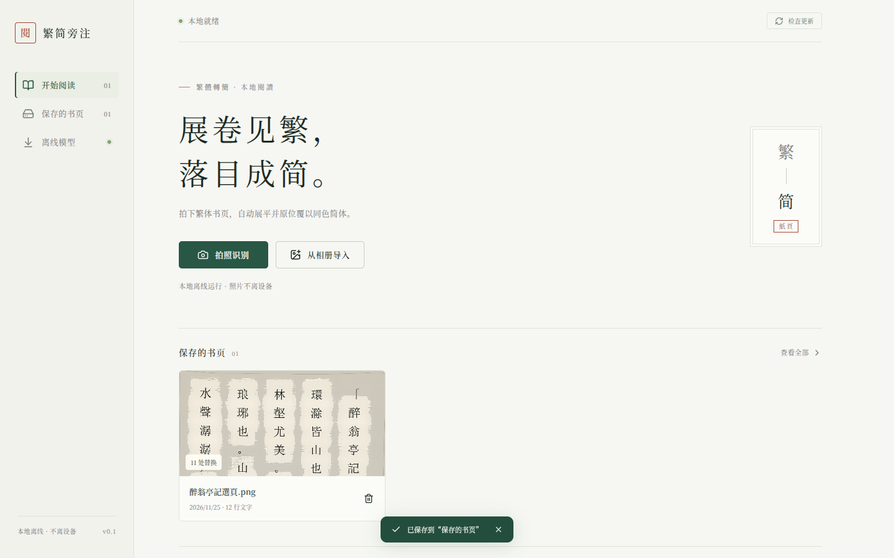
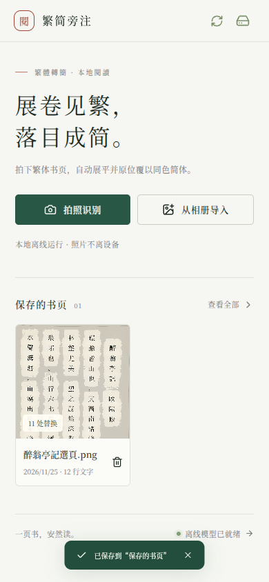
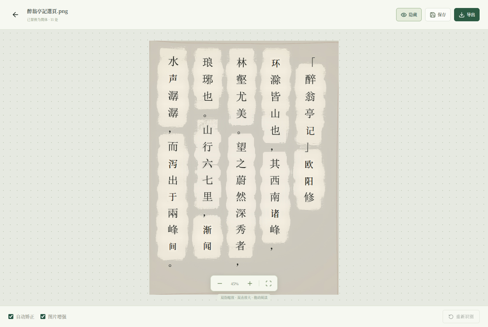
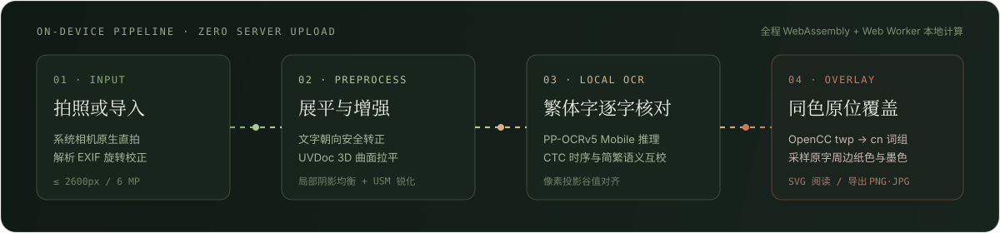

<p align="right">
  <strong>简体中文</strong> · <a href="README.en.md">English</a>
</p>

<div align="center">



<br />

<p>
  <a href="https://drivinggodj.github.io/fanjian-notes/"></a>
  
  
  
</p>

<p>
  <a href="https://drivinggodj.github.io/fanjian-notes/">立即打开使用</a> ·
  <a href="#界面一览">界面一览</a> ·
  <a href="#核心特性">核心特性</a> ·
  <a href="#工作原理">工作原理</a> ·
  <a href="#文档导航">文档导航</a>
</p>

</div>

> 拍下一页繁体书页，**繁简旁注（Fanjian Notes）** 在设备本地完成 3D 曲面展平、锐化增强与繁体识别，并按照纸面底色与墨色将对应的简体字**原位无缝覆盖**回原图。**照片、识别文本与阅读记录全程留在本机，不上传任何服务器。**

---

## 界面一览

首页采用极简东方书卷排版，界面与转换字体均由本地缓存的 **Adobe 思源宋体** 驱动，自动随系统切换浅色纸面与深色护眼主题。

<p align="center">
  <picture>
    <source media="(prefers-color-scheme: dark)" srcset="docs/screenshots/home-dark.png" />
    <source media="(prefers-color-scheme: light)" srcset="docs/screenshots/home.png" />
    
  </picture>
  <br />
  <sub>桌面端主界面（随系统自动切换浅色纸面 / 深色护眼外观）</sub>
</p>

<table>
  <tr>
    <td width="33%" align="center" valign="top">
      
      <br />
      <sub><strong>手机端极简首页</strong><br />离线模型未就绪时仅引导下载，就绪后直连系统原生相机与相册</sub>
    </td>
    <td width="67%" align="center" valign="top">
      
      <br />
      <sub><strong>原位同色替换实效（本地实时 OCR）</strong><br />仅保留「隐藏 / 显示」「保存」「导出」与底部重新识别开关，繁体原字原位覆盖同色简体</sub>
    </td>
  </tr>
</table>

---

## 核心特性

<table>
  <tr>
    <td width="50%" valign="top">
      <h3>📐 拍完直出，3D 展平与清晰增强</h3>
      移动端直接调起系统原生相机获取全分辨率样张，自动校验 JPEG EXIF 旋转与俯拍文字朝向，经 <strong>UVDoc 3D 曲面拉平</strong>与局部阴影均衡、USM 锐化后直接出图。如想对比原图，可按需取消勾选“自动矫正”或“图片增强”并点击“重新识别”。
    </td>
    <td width="50%" valign="top">
      <h3>🖋️ 原位同色替换，视觉不打断</h3>
      采用 OpenCC（<code>twp → cn</code>）进行整行上下文繁转简，并对长度变化的词组做局部锚点隔离；同时在每枚原字周边采样纸面底色与墨迹深浅，直接以相同纸色底衬与墨色覆盖思源宋体简体字，彻底告别遮挡行距的小号旁注。
    </td>
  </tr>
  <tr>
    <td width="50%" valign="top">
      <h3>📖 专注阅读与按需手存</h3>
      阅读器精简为“隐藏 / 显示”“保存”“导出”三项核心操作，支持双指缩放、拖移与无损 PNG / JPEG 全尺寸导出。应用<strong>不会默认自动留存历史</strong>——只有你主动点击“<strong>保存</strong>”的书页，才会出现在“保存的书页”书架中。
    </td>
    <td width="50%" valign="top">
      <h3>🔒 100% 离线 PWA 与智能换源</h3>
      基于 React 19、PaddleOCR.js（PP-OCRv5 Mobile）与 ONNX Runtime WebAssembly 在浏览器后台 Worker 独立推理。首次缓存应用与约 97 MB 离线模型后即可彻底断网使用，内置多镜像自动切换、断点字节进度与一键网络排障。
    </td>
  </tr>
</table>

---

## 工作原理

<p align="center">
  
</p>

> [!NOTE]
> **离线资源、隐私边界与能力说明**：
> - **首次资源体积**：完整离线能力需缓存静态应用文件、思源宋体字体，以及约 `67.2 MiB` 的 OCR 资源和约 `30.2 MiB` 的 UVDoc 3D 展平模型（总计约 `97 MB`）；全部模型准备好之前，主页将引导你先完成模型下载，再开放拍照与相册导入。
> - **隐私边界**：照片、识别结果与保存的书页始终保存在浏览器 IndexedDB 与 CacheStorage 中；GitHub Pages 仅用于下发静态应用及模型文件（托管方可能记录常规静态资源访问日志）。
> - **精度边界**：手机系统可能因存储空间紧张清理浏览器离线缓存，出行使用前建议在模型管理中检查一次；复杂古籍版式、严重模糊或强反光仍可能出现漏识与短语提示。

---

## 快速开始

### 手机 / 浏览器直接使用

1. 打开 **[在线应用](https://drivinggodj.github.io/fanjian-notes/)**（建议在 Safari 点击 **分享 → 添加到主屏幕**，或 Chrome 菜单选择 **安装应用**）。
2. 首页点击 **准备离线模型**（约 `97 MB`，内置加速镜像自动容错；下载慢时可在弹窗内展开“换源与网络诊断”）。
3. 准备就绪后，点击 **拍照识别** 或 **从相册导入**，稍候即可在原图上直接阅读简体替换效果，满意再点右上角 **保存** 或 **导出**。

<details>
<summary><strong>本地开发、HTTPS 手机联调与构建测试命令</strong>（点击展开）</summary>

需要 Node.js `>= 22.12.0`。首次运行 `predev` / `prebuild` 会通过 [scripts/prepare-ocr.mjs](scripts/prepare-ocr.mjs) 自动下载并校验 SHA-256 模型静态资源：

```powershell
pnpm install
pnpm dev          # 启动本地开发服务器 (http://localhost:5173)
pnpm dev:https    # 局域网 HTTPS 调试（配合 mkcert，供手机调起相机）
pnpm build        # 类型检查 (tsc -b) + Vite 生产打包 + PWA Service Worker 生成
pnpm test         # 运行 Vitest 算法单元测试
pnpm test:e2e     # 运行 Playwright 端到端真实浏览器测试
```

</details>

---

## 文档导航

| 想了解什么 | 入口文档 |
| --- | --- |
| 本地启动、局域网 HTTPS、功能明细与使用边界 | [使用与开发指南](docs/GUIDE.zh-CN.md) |
| GitHub Pages 自动发布与子路径静态资产说明 | [GitHub Pages 部署](docs/DEPLOYMENT.md) |
| 书页 3D 展平与逐字定位算法原理 | [矫正与定位说明](docs/RECTIFICATION.md) |
| 类型检查、单元测试与 Playwright 实测方案 | [测试记录](TESTING.md) |
| iOS 主屏幕书页图标母版（1024px） | [图标设计预览](docs/screenshots/icon-preview.png) · [1024 像素母版](public/icon-1024.png) |
| 缺陷反馈与功能建议 | [GitHub Issues](https://github.com/DrivingGodJ/fanjian-notes/issues) |

---

基于 React 19、PaddleOCR.js（PP-OCRv5 Mobile）、UVDoc（PaddleX）、OpenCC-js、ONNX Runtime Web、Canvas / SVG 与 Workbox PWA 构建。内嵌字体采用 Adobe 官方思源宋体（遵循 SIL Open Font License 1.1，详见 [OFL 许可文本](public/fonts/OFL.txt)）。
